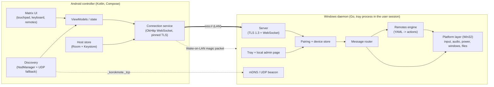

# Architecture

## Overview



One long-lived, authenticated WebSocket per phone carries everything. Text frames are JSON control messages; binary frames are compact high-rate input (pointer movement, scroll). See `PROTOCOL.md`.

## Repository layout

```
korokmote/
├── daemon/                  Go module: github.com/jose00735/korokmote/daemon
│   ├── cmd/
│   │   ├── korokmoted/      main (+ icon/manifest .syso resources)
│   │   └── korokctl/        CLI client (discover, pair, send, bench, remotes lint)
│   └── internal/
│       ├── app/             wiring, lifecycle, watchers (lock, foreground, clipboard, volume)
│       ├── config/          config.yaml, paths, defaults
│       ├── server/          TLS 1.3, WebSocket, sessions, rate limits, pairing endpoint
│       ├── pairing/         identity + certificate, device store, pairing windows, QR payload
│       ├── discovery/       own mDNS responder, UDP beacon
│       ├── proto/           message types, binary codec, key names, verification phrase
│       ├── router/          dispatch, permission checks, input worker
│       ├── remotes/         YAML loader, executor; builtin/*.yaml embedded
│       ├── platform/        interfaces, Fake, file browser
│       │   └── windows/     Win32 via the standard syscall package (build tag: windows)
│       ├── tray/            own Shell_NotifyIcon tray (Windows), no-op elsewhere
│       ├── adminui/         embedded loopback page (pairing QR, devices, permissions, logs)
│       ├── client/          Go client used by korokctl and the end-to-end test
│       ├── netinfo/         LAN addresses, MAC, peer checks
│       └── logring/         in-memory log tail for the admin page
├── android/                 Gradle project, single :app module
│   └── app/src/main/java/dev/korokmote/app/
│       ├── protocol/        message models, binary frames, phrase, key names
│       ├── net/             pinning, pairing, discovery, connection, manager, WoL
│       ├── data/            paired hosts (Keystore-encrypted tokens), settings
│       ├── service/         foreground service + media notification, Quick Settings tile
│       ├── design/          Matrix theme, rain, effects, components, haptics
│       └── ui/              navigation, screens, touchpad engine, remote renderer, QR scanner
├── protocol/
│   ├── wordlist.txt         256 words for verification phrases
│   └── vectors/             golden vectors used by both the Go and Kotlin tests
├── installer/               NSIS script and artwork
├── assets/                  icon sources
├── build.sh                 builds dist/ (Windows binaries, installer, zips)
├── docs/
└── .github/workflows/       ci.yml, release.yml
```

## Key decisions

### Go for the daemon, with almost no dependencies

A single static binary, no runtime to install, fast start, small memory footprint. Win32 is reached through the standard `syscall` package (DLLs loaded by absolute System32 path), and the tray icon and mDNS responder are implemented in-repo. The only third-party modules are `coder/websocket`, `skip2/go-qrcode` and `goccy/go-yaml`, none of which have dependencies of their own. Cross-compiling from any OS keeps CI simple. The platform layer is behind interfaces so Linux/macOS can be added later without touching the server or the remotes engine.

### The daemon is a tray process, not a Windows service

Windows services run in Session 0 and cannot send input to the interactive desktop. The daemon therefore runs inside the logged-in user's session and starts at logon. This is the single most important constraint on the Windows side; details in `DAEMON.md`.

### WebSocket over TLS 1.3, certificate pinned at pairing

- One TCP connection, works through any home router, trivial with OkHttp and Go.
- The daemon generates a self-signed certificate on first run. The phone learns its SHA-256 fingerprint from the pairing QR code and trusts only that certificate from then on. No certificate authority, no cloud.
- `TCP_NODELAY` is set on both ends. On a LAN this gives latency in the low milliseconds, so a separate UDP channel is not needed for v1. The binary frame format is transport-independent in case UDP is added later.

### JSON for control, binary for motion

Control messages are rare and benefit from being readable and easy to debug. Pointer movement arrives at up to 120 events per second and uses a 6-byte binary frame to avoid allocation and parsing cost on both sides.

### Remotes are data, served by the daemon

A remote (layout + actions) is a YAML file on the PC. The phone renders whatever the daemon describes, using a fixed set of widgets. Adding or editing a remote needs no app update. Actions are composed from a fixed list of primitives implemented in Go; there is no arbitrary scripting in v1.

### Phone-side state is small

The app stores paired hosts (name, last address, MAC, certificate fingerprint, device token) and user settings. Everything else comes from the daemon at connect time.

## Connection lifecycle

1. **Discover**: the app browses `_korokmote._tcp` and lists daemons; paired ones are matched by daemon ID.
2. **Pair** (once): scan the QR code shown by the daemon, exchange the one-time code for a long-lived device token.
3. **Connect**: TLS handshake (pin check), `hello` with the device token, daemon replies with capabilities and the remote list.
4. **Use**: the foreground service keeps the socket open while the app is in use or the media notification is active; heartbeat every 5 s.
5. **Reconnect**: exponential backoff from 250 ms to 8 s; address refreshed from discovery because DHCP may change it.
6. **Wake**: if the host is unreachable, the app offers to send a Wake-on-LAN packet to the stored MAC.

## Testing strategy

- `protocol/vectors`: binary frames, verification phrases and example messages. Go and Kotlin unit tests both run against the same files, so the two sides cannot drift.
- `daemon/internal/server/e2e_test.go`: pairing (QR and short code), pin rejection, single-use codes, lockout, live permission changes, held-key release on disconnect, revoke.
- `android/.../LiveDaemonTest.kt`: the app's own networking code against a running daemon (`-Pkorok.e2e=host:port:fp:code`).
- Daemon: platform interfaces have fakes; router and remotes engine are tested without Windows. Win32 code has a small set of tests that run only on the Windows CI runner.
- `korokctl`: scripted end-to-end checks against a running daemon and a latency benchmark (`korokctl bench`).
- Android: codec and view-model unit tests on the JVM; Compose screenshot tests for the design system components.
