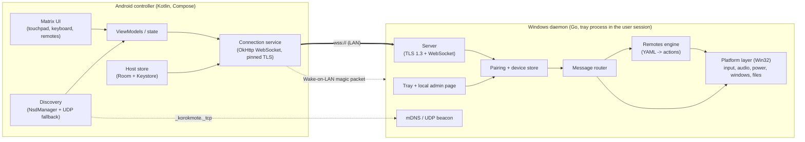

# Architecture

## Overview



One long-lived, authenticated WebSocket per phone carries everything. Text frames are JSON control messages; binary frames are compact high-rate input (pointer movement, scroll). See `PROTOCOL.md`.

## Repository layout

```
korokmote/
├── daemon/                  Go module: github.com/jose00735/korokmote/daemon
│   ├── cmd/
│   │   ├── korokmoted/      main: tray app + server
│   │   └── korokctl/        CLI test client (pair, send actions, measure latency)
│   └── internal/
│       ├── app/             wiring, lifecycle, single-instance lock
│       ├── config/          config file, paths, defaults
│       ├── server/          TLS, WebSocket, sessions, rate limits
│       ├── pairing/         certificate, tokens, QR payload, device store
│       ├── discovery/       mDNS advertisement, UDP beacon
│       ├── proto/           message types, binary frame codec, version negotiation
│       ├── router/          message -> handler dispatch, permission checks
│       ├── remotes/         YAML loader, layout model, action executor
│       ├── platform/        interfaces: Input, Audio, Power, Windows, Files, Clipboard
│       │   └── windows/     Win32 implementations (build tag: windows)
│       ├── tray/            tray icon and menu
│       └── adminui/         embedded local web page (pairing QR, devices, logs)
├── android/                 Gradle project
│   ├── app/                 navigation, DI graph, MainActivity
│   ├── core/
│   │   ├── protocol/        message models, binary codec (pure Kotlin, JVM-testable)
│   │   ├── network/         connection, TLS pinning, discovery, WoL
│   │   ├── data/            Room, DataStore, repositories
│   │   └── design/          Matrix theme, components, animations
│   └── feature/
│       ├── hosts/           discovery, pairing, host list
│       ├── touchpad/
│       ├── keyboard/
│       ├── media/
│       ├── power/
│       ├── remotes/         renders daemon-served layouts
│       ├── files/
│       └── settings/
├── protocol/
│   ├── schema/              JSON Schema for every message
│   └── vectors/             golden test vectors shared by Go and Kotlin tests
├── remotes/                 built-in remote definitions (YAML), embedded into the daemon
├── docs/
└── .github/workflows/
```

## Key decisions

### Go for the daemon

A single static binary, no runtime to install, fast start, small memory footprint, and good Win32 access through `golang.org/x/sys/windows` without cgo. Cross-compiling from any OS keeps CI simple. The platform layer is behind interfaces so Linux/macOS can be added later without touching the server or the remotes engine.

### The daemon is a tray process, not a Windows service

Windows services run in Session 0 and cannot send input to the interactive desktop. The daemon therefore runs inside the logged-in user's session and starts at logon. This is the single most important constraint on the Windows side; details in `DAEMON.md`.

### WebSocket over TLS 1.3, certificate pinned at pairing

- One TCP connection, works through any home router, trivial with OkHttp and Go.
- The daemon generates a self-signed certificate on first run. The phone learns its SHA-256 fingerprint from the pairing QR code and trusts only that certificate from then on. No certificate authority, no cloud.
- `TCP_NODELAY` is set on both ends. On a LAN this gives latency in the low milliseconds, so a separate UDP channel is not needed for v1. The binary frame format is transport-independent in case UDP is added later.

### JSON for control, binary for motion

Control messages are rare and benefit from being readable and easy to debug. Pointer movement arrives at up to 120 events per second and uses a 6-byte binary frame to avoid allocation and parsing cost on both sides.

### Remotes are data, served by the daemon

A remote (layout + actions) is a YAML file on the PC. The phone renders whatever the daemon describes, using a fixed set of widgets. Adding or editing a remote needs no app update. Actions are composed from a fixed list of primitives implemented in Go; there is no arbitrary scripting in v1.

### Phone-side state is small

The app stores paired hosts (name, last address, MAC, certificate fingerprint, device token) and user settings. Everything else comes from the daemon at connect time.

## Connection lifecycle

1. **Discover**: the app browses `_korokmote._tcp` and lists daemons; paired ones are matched by daemon ID.
2. **Pair** (once): scan the QR code shown by the daemon, exchange the one-time code for a long-lived device token.
3. **Connect**: TLS handshake (pin check), `hello` with the device token, daemon replies with capabilities and the remote list.
4. **Use**: the foreground service keeps the socket open while the app is in use or the media notification is active; heartbeat every 5 s.
5. **Reconnect**: exponential backoff from 250 ms to 8 s; address refreshed from discovery because DHCP may change it.
6. **Wake**: if the host is unreachable, the app offers to send a Wake-on-LAN packet to the stored MAC.

## Testing strategy

- `protocol/vectors`: each message has a golden encoded form. Go and Kotlin unit tests both encode and decode against the same files, so the two sides cannot drift.
- Daemon: platform interfaces have fakes; router and remotes engine are tested without Windows. Win32 code has a small set of tests that run only on the Windows CI runner.
- `korokctl`: scripted end-to-end checks against a running daemon and a latency benchmark (`korokctl bench`).
- Android: codec and view-model unit tests on the JVM; Compose screenshot tests for the design system components.
